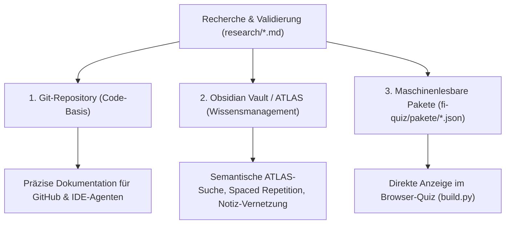

# FI-Lernspiele – Recherche, Wissensbasis & Validierung

**Stand:** 15.10.2026 · **Zweck:** Zentrale Wissens-, Quellen- und Spezifikationsbasis für das Fachinformatiker-Lernspiel (Grundstufe / AP1: LF01–LF05).  
**Verwendung in anderen Chats:** Jeder KI-Agent oder Entwickler kann diese Berichte über die relativen Pfade im Ordner `research/` laden, um konsistente, geprüfte Inhalte ohne Neuerfindung zu generieren.

---

## 1. Übersicht der Recherche-Module

| Datei | Titel / Inhalt | Relevante Lernfelder | Kerninhalte für andere Chats |
|---|---|---|---|
| [`01-offene-datensaetze-und-fragensammlungen.md`](./01-offene-datensaetze-und-fragensammlungen.md) | Offene Datensätze & Fragenpools | LF03, LF04, LF05 | IANA Ports (CSV), IEEE OUI MAC-Hersteller, BSI IT-Grundschutz (dl-de/by-2-0), OWASP Top 10, Chinook SQLite-DB, OER-Quellen. |
| [`02-lernspiele-und-mechaniken.md`](./02-lernspiele-und-mechaniken.md) | Vergleichbare Lernspiele & Spielmechaniken | LF03, LF04, LF05 | Analyse von 23 Projekten (Filius, SQL Murder Mystery, Flexbox Froggy, Bandit, CyberChef), Lernwissenschaftliche Evidenz (Retrieval Practice), 8 konkrete Minispiel-Entwürfe. |
| [`03-generator-spezifikationen.md`](./03-generator-spezifikationen.md) | Generator-Spezifikationen & Rechenregeln | LF03, LF04, LF05 | Exakte Formeln, Grenzwerte und Distraktoren für Subnetting, IPv6 RFC 5952, Datenübertragungszeit (SI vs. IEC), Verfügbarkeit, RAID, USV, 2er-Komplement. |
| [`04-fachquellen-und-faktencheck.md`](./04-fachquellen-und-faktencheck.md) | Primärquellen, Normen & Faktencheck | LF01–LF05, AP1 | RFCs (791, 8200, 5952, 9293!), IEEE 802.3/802.1Q, DIN EN 50173, BSI 200-2, DSGVO, KMK-Lehrplan + 15 entkräftete IT-Mythen. |
| [`05-praxisszenarien-und-modellunternehmen.md`](./05-praxisszenarien-und-modellunternehmen.md) | Praxisszenarien & Modellunternehmen | LF03, LF04, LF05 | Vollständiges Modellunternehmen „MedTech Sanitas GmbH“ (Netzplan, VLANs, USV/RAID, BSI-Analyse), 18 handlungsorientierte AP1-Aufgaben, 5 reale IT-Vorfälle (CrowdStrike 2024, Anhalt-Bitterfeld etc.). |
| [`05-modellunternehmen.sql`](./05-modellunternehmen.sql) | SQL-Beispieldatenbank | LF05 | Fertiges relationales Schema mit Beispieldaten (SQLite/MySQL/PostgreSQL), direkt lauffähig in `sql.js` im Browser. |

---

## 2. Speicher- und Ablagestrategie

Um das erarbeitete Wissen sowohl für die Web-Entwicklung als auch für das persönliche Lernen und weitere KI-Chats optimal zu nutzen, empfiehlt sich ein dreistufiges Ablagekonzept:



### Stufe 1: Im Git-Repository (`fi-lernspiele/research/`) – *Bereits umgesetzt*
- **Vorteil:** Liegt direkt beim Code, versioniert, jeder KI-Agent in Antigravity / Cursor / VS Code hat sofortigen Vollzugriff.
- **Zweck:** Spezifikationen für Generatoren, Musterlösungen und Quellennachweise.

### Stufe 2: Im Obsidian-Vault / ATLAS
- **Vorschlag:** Die Inhalte können in den persönlichen Obsidian-Vault gespiegelt oder verlinkt werden (z. B. nach `30_Projekte/FI-Lernspiele/` oder die Handouts nach `35_Handouts/`).
- **Vorteil:** Über den lokalen ATLAS MCP-Server (`atlas_vault_search`) werden diese Inhalte semantisch indizierbar und lassen sich direkt mit Begriffserklärungen (`20_Begriffe/`) und Unterrichtsnotizen vernetzen.

### Stufe 3: Als strukturierte JSON-Pakete (`fi-quiz/pakete/*.json`)
- **Vorschlag:** Die 18 Praxisszenarien aus `05-praxisszenarien-und-modellunternehmen.md` und die Port-Tabellen aus `01` können direkt in das bestehende Paket-Format des Spiels überführt werden:
  ```json
  {
    "id": "lf03-praxis-medtech",
    "titel": "LF03 – Praxisnetz MedTech Sanitas",
    "fragen": [ ... ]
  }
  ```
- **Vorteil:** Durch Aufruf des im Repo vorhandenen `build.py` werden die neuen Pakete automatisch in das statische Browser-Quiz (`index.html`) einkompiliert.

---

## 3. Kurzleitfaden: So nutzt du diese Dateien in neuen Chats

Wenn du in einem neuen Chat an einem bestimmten Feature arbeitest, gib dem Agenten einfach eine der folgenden Aufforderungen mit:

- **Für neue Quizfragen:**  
  *„Lies `research/05-praxisszenarien-und-modellunternehmen.md` und erstelle 5 neue Multiple-Choice-Fragen im Kontext der MedTech Sanitas GmbH.“*
- **Für neue Rechengeneratoren:**  
  *„Lies `research/03-generator-spezifikationen.md` und implementiere den JavaScript-Generator für IPv4-Subnetting inklusive der dort definierten Distraktoren.“*
- **Für Fakten- und Begriffsüberprüfung:**  
  *„Prüfe die Antworten gegen `research/04-fachquellen-und-faktencheck.md`, insbesondere die Tabelle der 15 häufigen Mythen.“*
- **Für interaktive Minispiele:**  
  *„Lies `research/02-lernspiele-und-mechaniken.md` und baue einen Prototyp für das dort beschriebene Minigame 'Firewall Packet Filter'.“*
